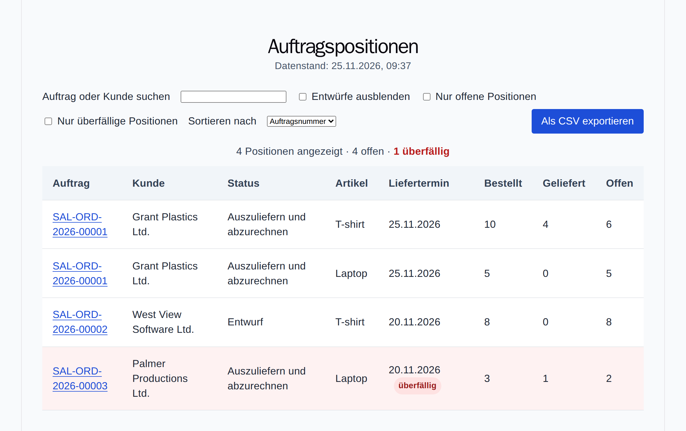
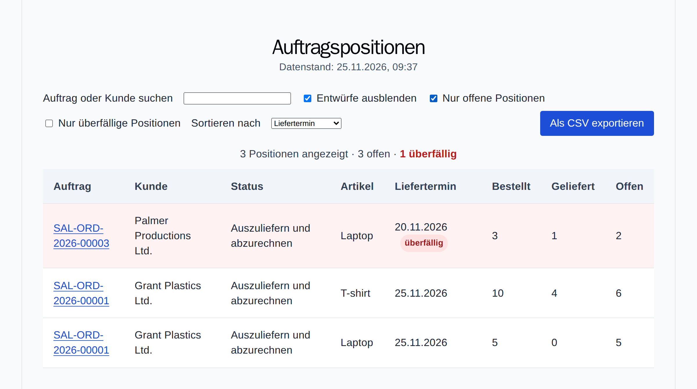
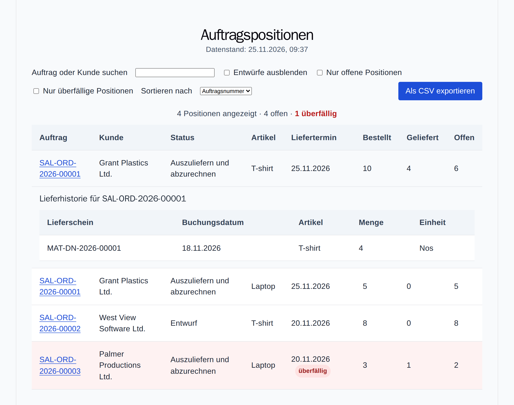

# ERP-Auftrags- und Lieferübersicht

## Ziel des Projekts

Dieses Projekt dient dazu, den Umgang mit einem ERP-System am Beispiel von ERPNext zu üben. Das Ziel ist, Kundenaufträge über die ERPNext-API abzurufen, die Daten mit Python zu filtern und die Ergebnisse in einer Weboberfläche mit React und TypeScript darzustellen.

Die Anwendung zeigt bestellte, gelieferte und offene Mengen pro Auftragsposition. Python importiert Aufträge und gebuchte Lieferpositionen nach PostgreSQL. FastAPI berechnet die offene Menge in der Datenbankabfrage und stellt die Positionen über `/api/orders` bereit. In der Oberfläche lassen sich die Positionen durchsuchen, auf offene oder überfällige Positionen eingrenzen, nach Liefertermin sortieren, Entwürfe ausblenden und als CSV-Datei exportieren. Ein Klick auf die Auftragsnummer öffnet die Lieferhistorie mit Lieferscheinnummer, Buchungsdatum, Artikel, Menge und Einheit.

## Funktionen

- **Liefertermin und Überfälligkeit:** Der Import übernimmt den Liefertermin
  jeder Auftragsposition aus ERPNext (`delivery_date`, ersatzweise den des
  Auftrags). Eine Position gilt als überfällig, wenn noch eine offene Menge
  besteht, der Liefertermin vor dem heutigen Datum liegt und der Auftrag
  nicht den Status Entwurf, Abgeschlossen, Geschlossen oder Storniert hat.
  FastAPI berechnet das in der Datenbankabfrage.
- **Filter und Sortierung:** Suche nach Auftragsnummer oder Kunde, Entwürfe
  ausblenden, nur offene oder nur überfällige Positionen anzeigen, Sortierung
  nach Auftragsnummer oder Liefertermin.
- **Kennzahlen:** Über der Tabelle steht, wie viele Positionen angezeigt
  werden und wie viele davon offen und überfällig sind.
- **CSV-Export:** Die gefilterte und sortierte Liste lässt sich als CSV-Datei
  herunterladen. Die Datei verwendet Semikolons, deutsches Datums- und
  Zahlenformat und UTF-8 mit BOM, damit Excel sie mit deutschen Einstellungen
  direkt korrekt öffnet.
- **Datenstand:** Unter der Überschrift steht der Zeitpunkt des letzten
  erfolgreichen Imports mit `sync_order.py`.
- **Lieferhistorie:** Ein Klick auf die Auftragsnummer zeigt die gebuchten
  Lieferscheinpositionen des Auftrags.

### API-Endpunkte

| Endpunkt | Inhalt |
| --- | --- |
| `GET /api/orders` | Alle Auftragspositionen mit offener Menge, Liefertermin und `is_overdue` |
| `GET /api/orders/{auftragsnummer}/deliveries` | Gebuchte Lieferpositionen eines Auftrags |
| `GET /api/sync-status` | Zeitpunkt des letzten Imports (`synced_at`, `null` falls noch nie importiert) |

## Screenshots

Die Beispieldaten stammen aus einer ERPNext-Testinstanz. Für die Screenshots
wurde der Liefertermin von zwei Positionen auf den 20.11.2026 gesetzt, damit
eine überfällige Position zu sehen ist.

### Übersicht der Auftragspositionen

Jede Zeile entspricht einer Auftragsposition. Neben Kunde, Status, Artikel
und Liefertermin zeigt die Tabelle die bestellte, die gelieferte und die noch
offene Menge. Überfällige Positionen sind rot hinterlegt und tragen den
Hinweis „überfällig“. Der ERPNext-Status wird auf Deutsch angezeigt, zum
Beispiel `Draft` als „Entwurf“. Der Auftrag im Status „Entwurf“ gilt trotz
verstrichenem Liefertermin nicht als überfällig.



### Filter, Sortierung und Export

Über das Suchfeld lassen sich Positionen nach Auftragsnummer oder Kundenname
finden. Mit „Entwürfe ausblenden“ verschwinden Aufträge im Status „Entwurf“,
mit „Nur offene Positionen“ bleiben nur Positionen mit einer offenen Menge
größer als null sichtbar, mit „Nur überfällige Positionen“ nur überfällige.
Bei der Sortierung nach Liefertermin stehen die frühesten Termine oben.
„Als CSV exportieren“ lädt genau die angezeigten Positionen in dieser
Reihenfolge herunter.



### Lieferhistorie

Ein Klick auf eine Auftragsnummer klappt unter der Zeile die gebuchten
Lieferpositionen dieses Auftrags auf. Ein erneuter Klick schließt sie wieder.



## Entwicklungsumgebung

Das Repository liegt auf einem Ubuntu-Server, der unter Proxmox läuft.
Die Bearbeitung erfolgt vom lokalen Rechner aus mit Visual Studio Code
und der Erweiterung Remote - SSH. Das Projektverzeichnis wird in VS Code
über die SSH-Verbindung geöffnet. Die Befehle in dieser Anleitung werden
im Terminal der SSH-Sitzung auf dem Ubuntu-Server ausgeführt.

## Voraussetzungen

- Python 3 und eine virtuelle Umgebung
- Docker mit dem Compose-Plugin
- Node.js 20 ab 20.19 oder Node.js ab 22.12 sowie npm
- Zugang zu einer ERPNext-Instanz und API-Zugangsdaten mit Leserechten für Kundenaufträge (`Sales Order`) und Lieferscheine (`Delivery Note`)

## Einmalige Einrichtung

Öffne in VS Code über Remote - SSH den Ordner `erp-order-shipment-tracker`
auf dem Ubuntu-Server. Das ist das Projektverzeichnis mit `README.md`,
`compose.yaml`, `schema.sql` und dem Unterordner `frontend/`.
Öffne dort ein Bash-Terminal. Mit `pwd` kannst du den aktuellen Pfad prüfen.

### Umgebungsvariablen

Lege `.env` direkt im Projektverzeichnis neben `compose.yaml` an.
Der folgende Befehl behält eine vorhandene `.env` bei.

```bash
test -f .env || cp .env.example .env
```

| Variable | Verwendung |
| --- | --- |
| `DB_USER` | PostgreSQL-Benutzer für Docker Compose, den Import und FastAPI |
| `DB_PASSWORD` | PostgreSQL-Passwort für Docker Compose, den Import und FastAPI |
| `ERP_BASE_URL` | Basis-URL der ERPNext-Instanz, ohne `/api/resource` |
| `ERP_API_KEY` | API-Schlüssel für ERPNext |
| `ERP_API_SECRET` | API-Secret für ERPNext |
| `ERP_ORDER_NUMBER` | Auftragsnummer für den Einzelabruf mit `get_order.py` |

Trage die tatsächlichen Werte in `.env` ein. Verwende pro Zeile
`VARIABLE=Wert` ohne Leerzeichen um das Gleichheitszeichen. Für Werte mit
Leerzeichen oder einem Dollarzeichen eignen sich einfache Anführungszeichen,
zum Beispiel `DB_PASSWORD='beispiel$wert'`. Docker Compose liest die Datei
im Projektverzeichnis automatisch. Für Python wird sie im jeweiligen
Bash-Terminal wie unten gezeigt geladen.

Git ignoriert `.env` und `frontend/.env.local`. Die versionierte
`.env.example` enthält Platzhalter. Verwende bei einem bereits
initialisierten PostgreSQL-Volume den vorhandenen Benutzernamen und das
dazugehörige Passwort. Falls `DB_USER` in einer vorhandenen `.env` fehlt,
trage den bisherigen PostgreSQL-Benutzernamen dort ein.

### Abhängigkeiten und Datenbankschema

Im Projektverzeichnis auf dem Ubuntu-Server ausführen.

```bash
python3 -m venv .venv
source .venv/bin/activate
python -m pip install fastapi uvicorn 'psycopg[binary]'

docker compose up -d
timeout 60s bash -c 'until docker compose exec -T postgres sh -c "pg_isready -q -h 127.0.0.1 -U \"\$POSTGRES_USER\" -d erp_tracker"; do sleep 1; done' &&
  docker compose exec -T postgres sh -c 'psql -v ON_ERROR_STOP=1 -U "$POSTGRES_USER" -d erp_tracker' < schema.sql
```

Führe die Schemaeinrichtung beim Anlegen einer neuen Datenbank aus.
Für eine bestehende Datenbank wende nach jedem Update einmal `schema.sql` erneut an. Das Skript legt fehlende Tabellen und Spalten an, etwa die Tabelle für die Lieferhistorie, die Spalte für den Liefertermin und die Tabelle für den Datenstand. Führe danach `python sync_order.py` aus, damit die Liefertermine importiert werden:

```bash
docker compose exec -T postgres sh -c 'psql -v ON_ERROR_STOP=1 -U "$POSTGRES_USER" -d erp_tracker' < schema.sql
```

PostgreSQL ist auf dem Ubuntu-Server über `127.0.0.1:5433` erreichbar.

Installiere anschließend die Frontend-Abhängigkeiten im Unterordner `frontend/`.
Beginne den folgenden Block im Projektverzeichnis.

```bash
cd frontend
npm ci
```

## Bei jeder neuen Sitzung starten

### Terminal 1 im Projektverzeichnis

Öffne ein Terminal im Ordner `erp-order-shipment-tracker` auf dem Ubuntu-Server.
Aktiviere die virtuelle Umgebung und lade `.env` erneut in diese Shell.

```bash
source .venv/bin/activate
set -a
source ./.env
set +a

docker compose up -d
timeout 60s bash -c 'until docker compose exec -T postgres sh -c "pg_isready -q -h 127.0.0.1 -U \"\$POSTGRES_USER\" -d erp_tracker"; do sleep 1; done' &&
  python -m uvicorn main:app --reload --host 127.0.0.1 --port 8001
```

### Terminal 2 im Ordner frontend/

Öffne ein zweites Terminal im Projektverzeichnis auf dem Ubuntu-Server.
Wechsle in `frontend/` und starte Vite.

```bash
cd frontend
npm run dev -- --host 127.0.0.1 --port 5173 --strictPort
```

Leite in der Ansicht **Ports** von VS Code den Serverport `5173` weiter.
Öffne die dort angezeigte lokale Adresse im Browser. Vite leitet Anfragen an
`/api` auf dem Ubuntu-Server standardmäßig an `http://127.0.0.1:8001` weiter.

Falls in `frontend/.env.local` ein `API_PROXY_TARGET` gesetzt ist, verwendet
Vite diese Adresse. Für das oben gezeigte Setup kannst du dort
`API_PROXY_TARGET=http://127.0.0.1:8001` eintragen. Starte Vite nach einer
Änderung an der Datei neu.

## Aufträge abrufen und aktualisieren

Für den ersten Import und für spätere Aktualisierungen ein weiteres
Bash-Terminal im Projektverzeichnis auf dem Ubuntu-Server öffnen und bei
laufender Datenbank ausführen.

```bash
source .venv/bin/activate
set -a
source ./.env
set +a
python sync_order.py
```

Lade anschließend die Seite im Browser neu. Klicke auf eine Auftragsnummer, um
die gebuchten Lieferpositionen dieses Auftrags zu sehen. Im selben Terminal kannst du mit
`python list_orders.py` Aufträge aus ERPNext auflisten oder mit
`python get_order.py` den in `ERP_ORDER_NUMBER` gesetzten Auftrag abrufen.
